# Скриншоты дашбордов

Снято 4 ноября 2026 года. Живые дашборды открываются по ссылкам из [README](../../README.md), пока работает сервер.

## Мировой рынок велошеринга (Metabase)

Ежедневный снимок каталога CityBikes, население стран и городов из GeoNames.

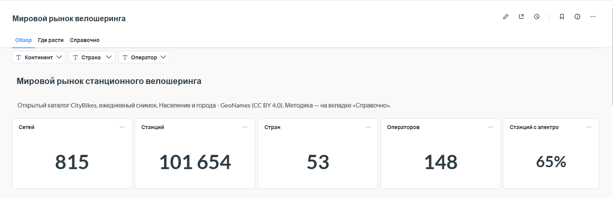

Сводка по каталогу: 815 сетей, 101 654 станции в 53 странах.

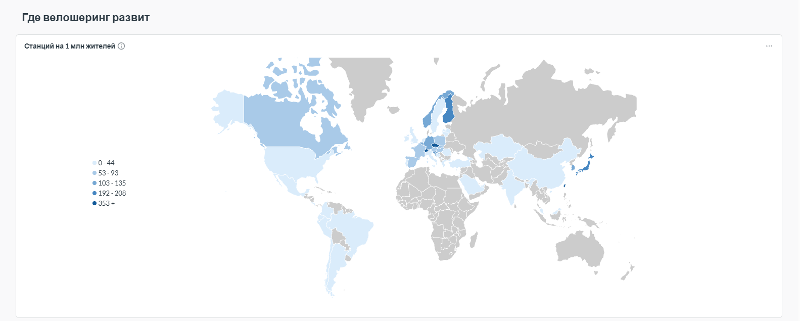

Насыщенность велошерингом: станций на 1 млн жителей.

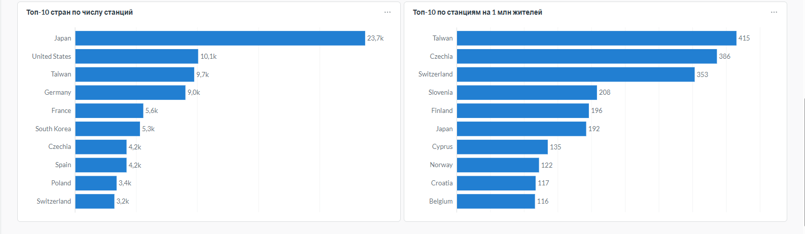

По числу станций лидирует Япония, по плотности — Тайвань, Чехия и Швейцария.

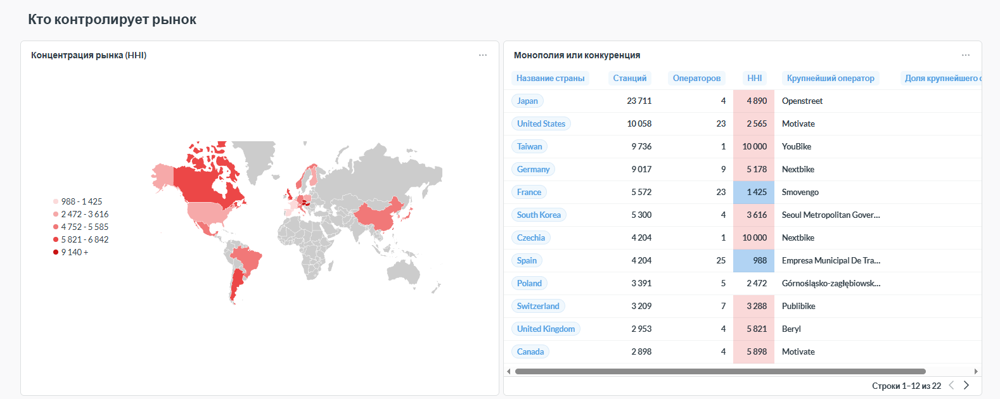

Индекс Херфиндаля–Хиршмана: в Тайване и Чехии один оператор, во Франции и Испании рынок поделен.

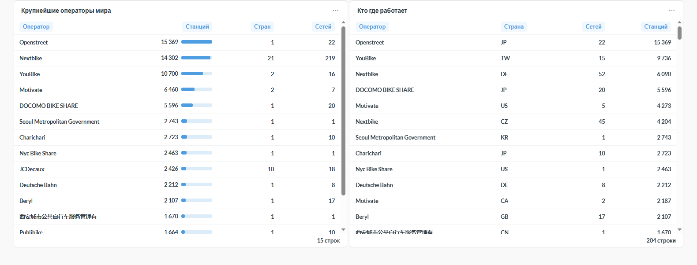

Крупнейшие операторы и страны, где они работают.

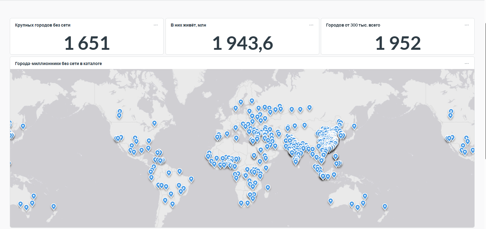

Вкладка «Где расти»: города от 300 тыс. жителей, у которых ближайшая сеть дальше 25 км. На карте — миллионники.

## Спрос в Германии (Metabase)

20 сетей Германии опрашиваются раз в 10 минут, поездки оцениваются по изменениям числа велосипедов на станциях.

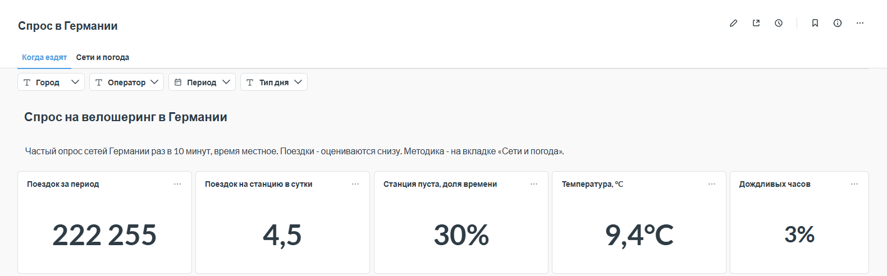

Сводка: поездки, поездок на станцию в сутки, доля времени без велосипедов, погода.

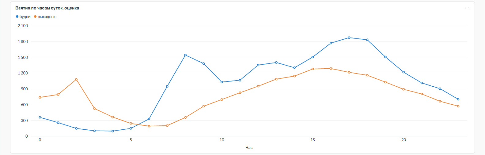

В будни два пика — в 8 и в 17–18 часов. Ночной всплеск выходных в 2 часа — 25 октября, когда при переходе на зимнее время этот час прошёл дважды.

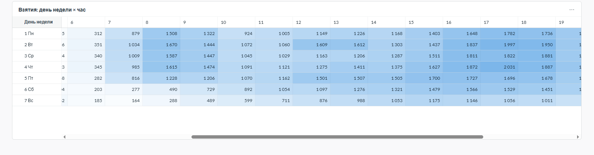

Тепловая карта: день недели × час.

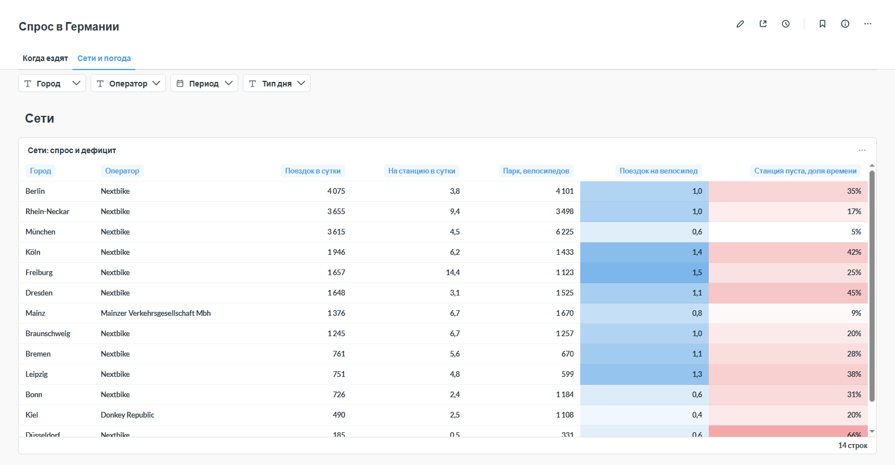

Вкладка «Сети и погода»: поездки, оборот велосипеда и доля времени без велосипедов по сетям.

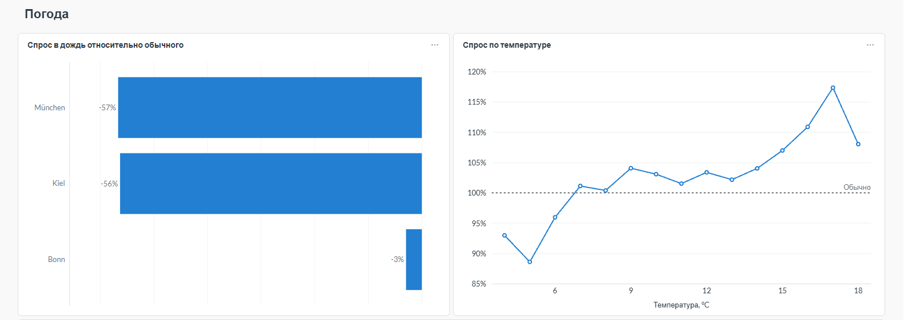

Спрос в дождливые часы относительно сухих и зависимость от температуры.

## Дефицит и перекосы (Metabase)

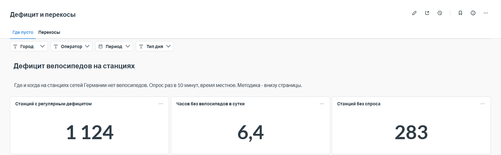

Станции с регулярным дефицитом, часы без велосипедов в сутки, станции без спроса.

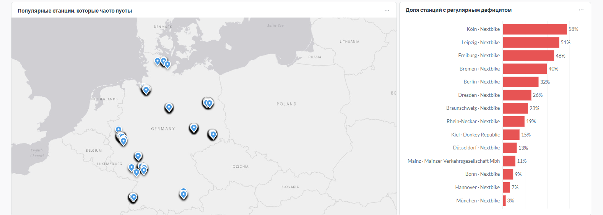

Популярные станции, которые часто пусты, и доля таких станций по сетям.

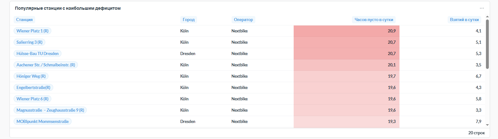

Станции, где велосипедов нет большую часть суток.

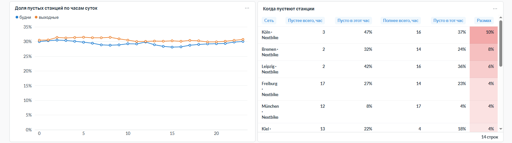

Доля пустых станций по часам суток и самые «пустые» часы каждой сети.

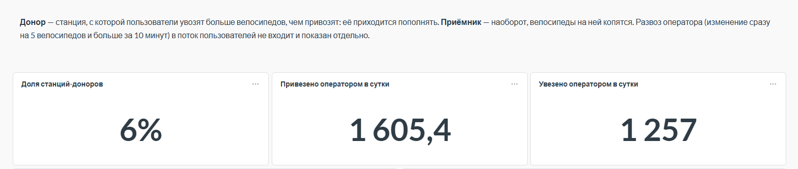

Вкладка «Перекосы»: станции-доноры и приёмники, объём развоза оператора.

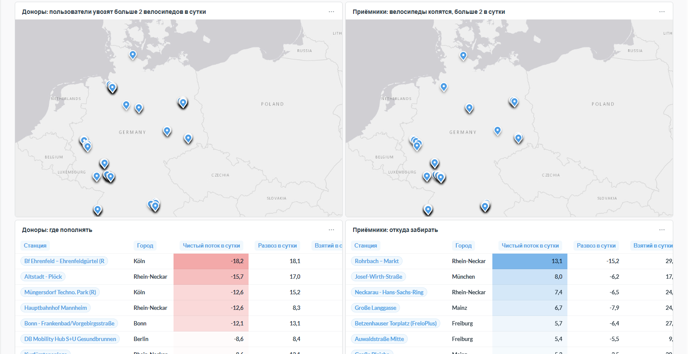

Где пополнять станции и откуда забирать лишние велосипеды.

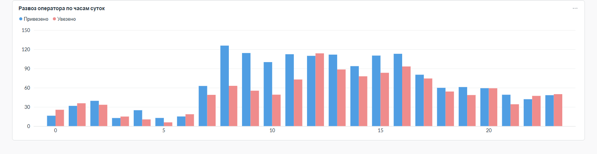

Развоз оператора по часам суток: изменения сразу на 5 велосипедов и больше за 10 минут.

## Здоровье пайплайна (Yandex DataLens)

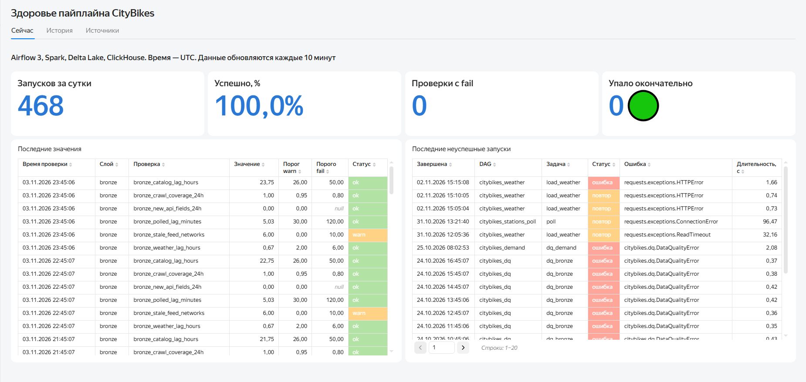

Запуски задач за сутки, проверки качества, последние неуспешные запуски.

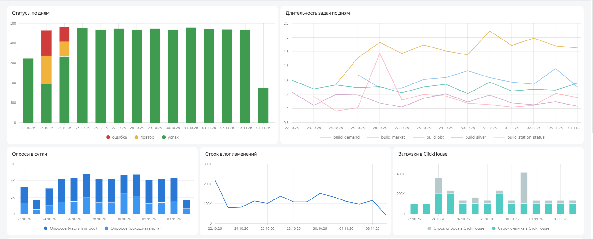

Статусы задач по дням (23–24 октября — простой из-за прав на таблицу), длительность Spark-задач, объёмы опросов и загрузок в ClickHouse.

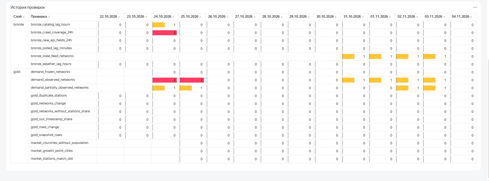

Худший результат каждой проверки за день.

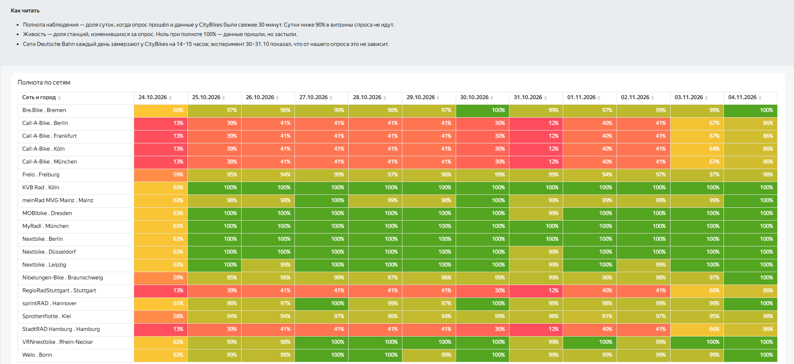

Доля суток, когда данные сети были свежими. Сети Deutsche Bahn каждый день замерзают на стороне CityBikes, поэтому у них полнота ниже 90%.

## Airflow

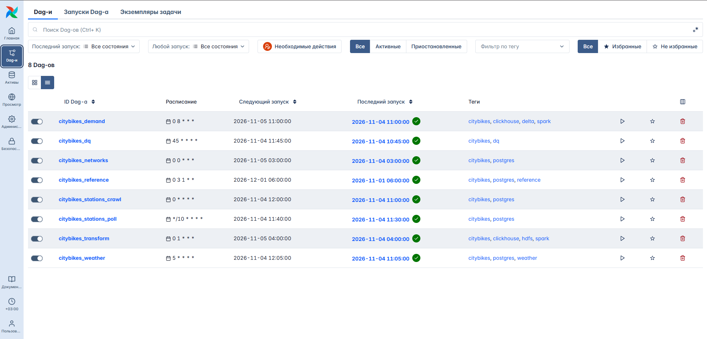

Восемь DAG'ов: опрос станций раз в 10 минут, краулер каталога, погода, проверки качества, ежесуточные трансформации и витрины спроса.

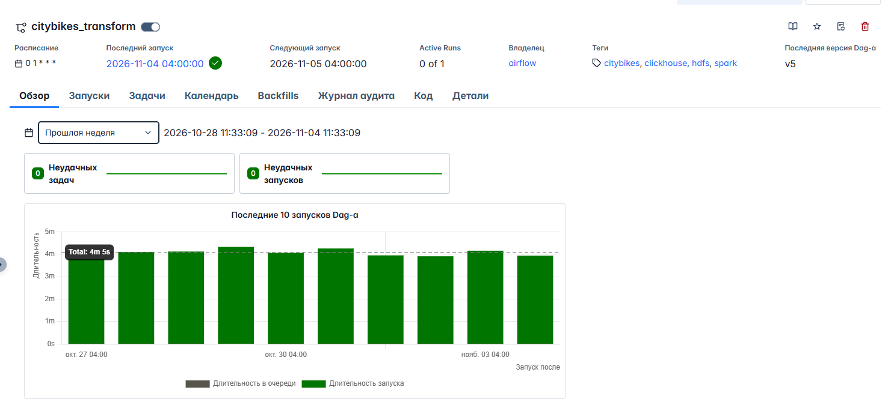

Ежесуточная сборка silver и gold: последние 10 запусков по 4 минуты, без ошибок.

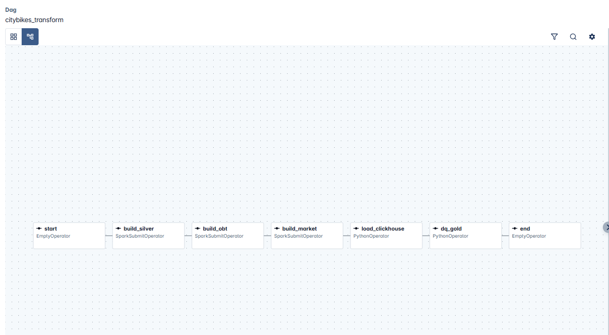

Цепочка задач: silver → витрина станций → мировой рынок → загрузка в ClickHouse → проверки gold.
